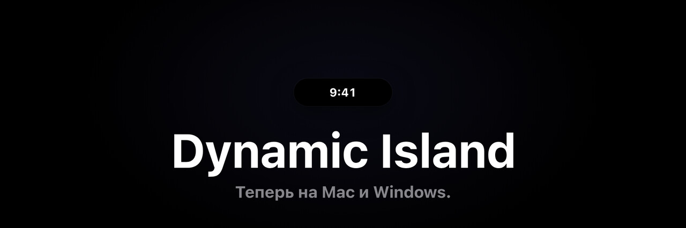
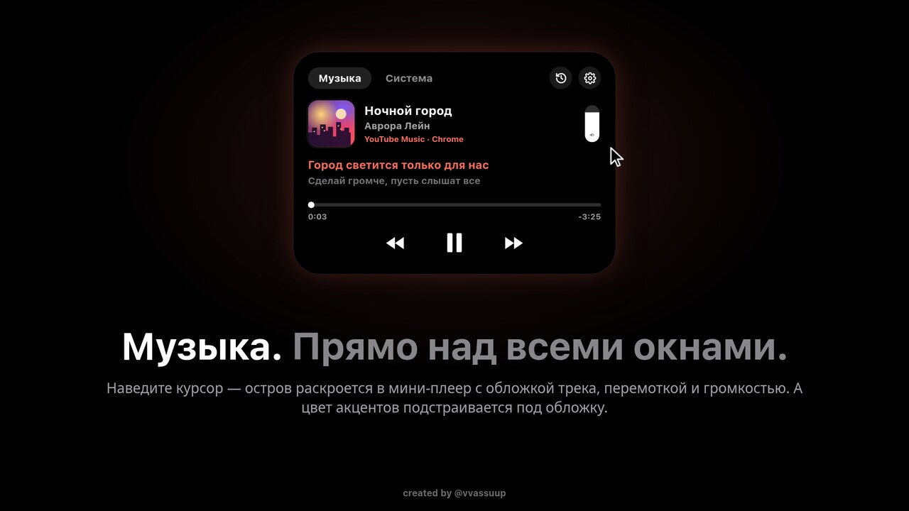
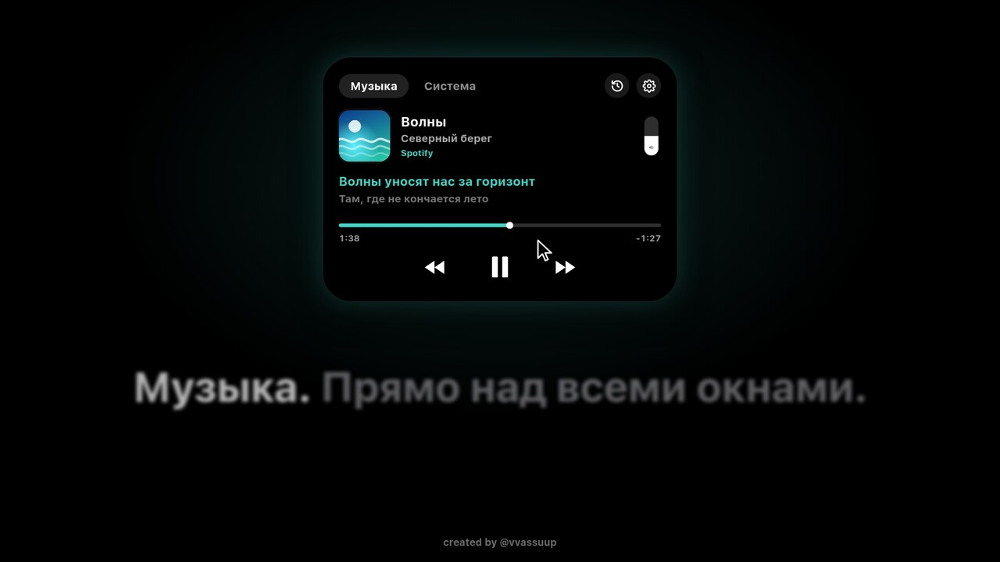
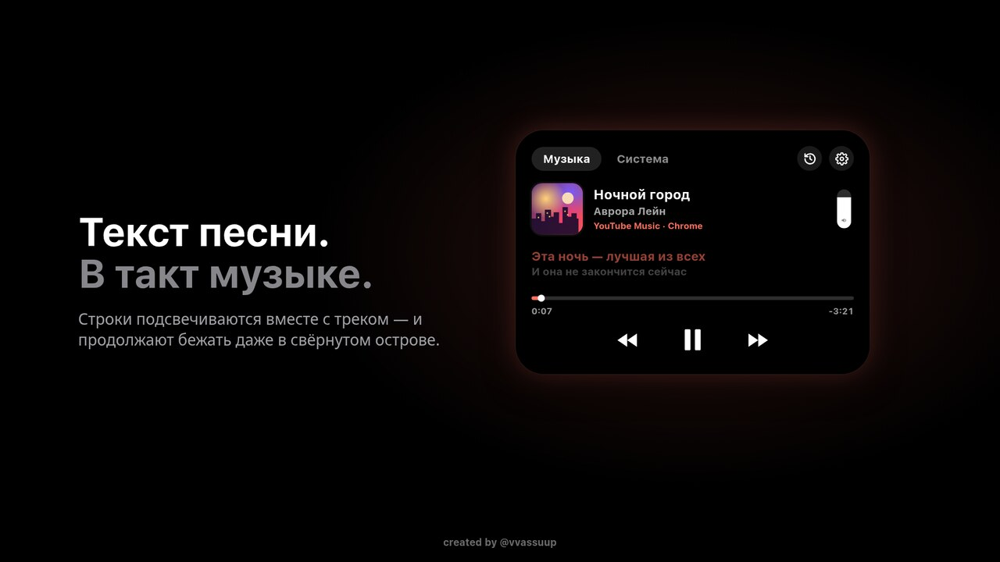
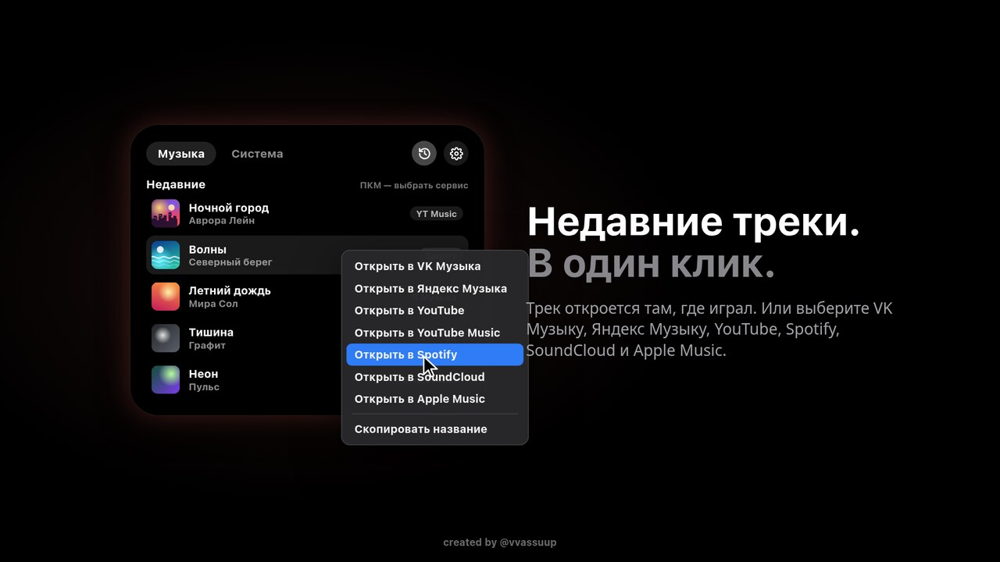
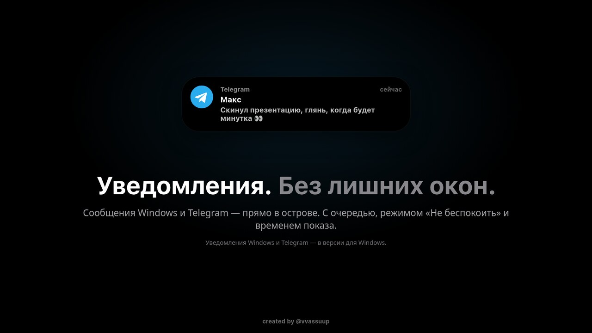
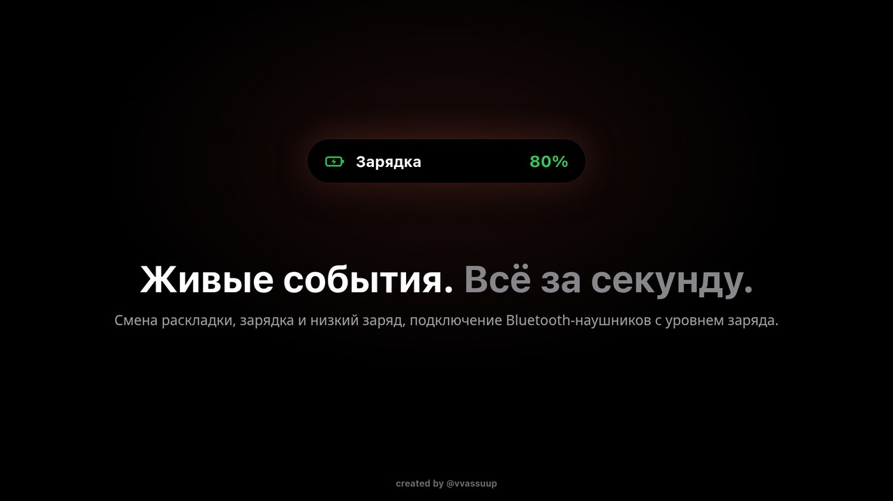
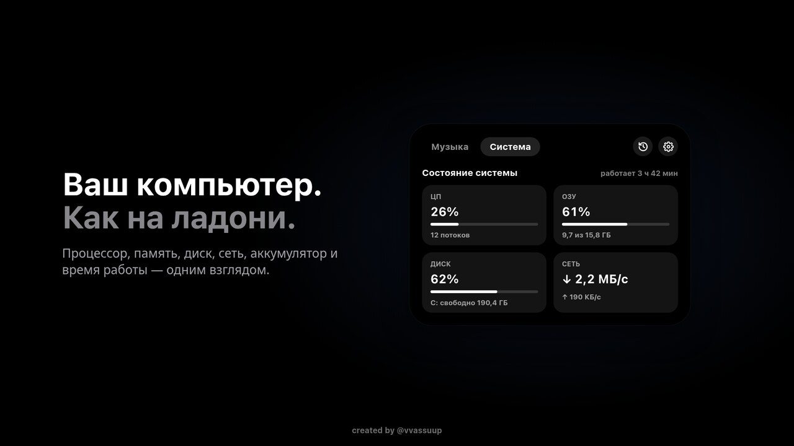
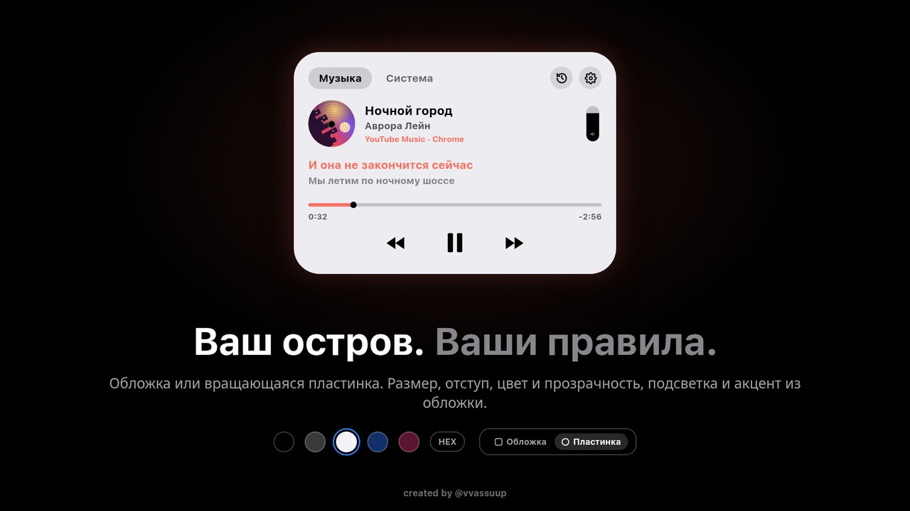

<div align="center">



# Dynamic Island

<b>Тот самый «остров» с iPhone — теперь на Mac и Windows.</b>

Музыка, текст песни, уведомления и живые события — в аккуратной капсуле над всеми окнами.


### [⬇️ Скачать последнюю версию](../../releases/latest)

</div>


## ✨ Возможности

<table>
<tr>
<td width="50%" valign="top">

### 🎵 Музыка над всеми окнами
Наведите курсор — остров раскроется в мини-плеер с обложкой, перемоткой и громкостью.



</td>
<td width="50%" valign="top">

### 🎨 Цвет под обложку
Акценты и подсветка острова подстраиваются под обложку трека.



</td>
</tr>
<tr>
<td width="50%" valign="top">

### 🎤 Текст песни в такт
Строки подсвечиваются вместе с треком и продолжают бежать даже в свёрнутом острове.



</td>
<td width="50%" valign="top">

### 🕘 Недавние треки в один клик
Откройте трек там, где он играл, — или в VK Музыке, Яндекс Музыке, YouTube, Spotify, SoundCloud и Apple Music.



</td>
</tr>
<tr>
<td width="50%" valign="top">

### 💬 Уведомления без лишних окон
Сообщения Windows и Telegram прямо в острове: очередь, «Не беспокоить», время показа.



</td>
<td width="50%" valign="top">

### ⚡ Живые события
Смена раскладки, зарядка и низкий заряд, подключение Bluetooth-наушников с уровнем заряда.



</td>
</tr>
<tr>
<td width="50%" valign="top">

### 📊 Компьютер как на ладони
Процессор, память, диск, сеть, аккумулятор и время работы — одним взглядом.



</td>
<td width="50%" valign="top">

### 💿 Ваш остров — ваши правила
Обложка или вращающаяся пластинка, размер, отступ, цвет, прозрачность и подсветка.



</td>
</tr>
</table>

> [!NOTE]
> Уведомления Windows и Telegram доступны в версии для Windows.

---

## 📥 Установка

Откройте страницу [**Releases**](../../releases/latest) и скачайте файл для своей системы:

| Система | Файл | Требования |
|---|---|---|
| 🍎 macOS | `DynamicIsland-4.4.0-macOS.dmg` | macOS 13 Ventura и новее, Mac на Apple Silicon (M1 и новее) |
| 🪟 Windows | `DynamicIsland-4.4.0-Windows-Setup.exe` | Windows 10 (версия 2004+) или Windows 11 |

### 🍎 macOS

1. Откройте `DynamicIsland-4.4.0-macOS.dmg`.
2. Перетащите **Dynamic Island** в папку **Программы**.
3. Запустите приложение из **Программ** — остров появится вверху экрана.

<details>
<summary><b>macOS пишет «приложение повреждено» или не даёт открыть</b></summary>

<br>

Приложение не заверено Apple (это платно), поэтому macOS осторожничает. Откройте **Терминал** и выполните:

```bash
xattr -cr "/Applications/Dynamic Island.app"
```

После этого снова запустите приложение из **Программ**.

</details>

### 🪟 Windows

1. Запустите `DynamicIsland-4.4.0-Windows-Setup.exe`.
2. Если появилось синее окно **«Windows защитила ваш компьютер»** — нажмите **Подробнее → Выполнить в любом случае**.
3. Пройдите установку — остров появится вверху экрана.

<details>
<summary><b>Почему Windows предупреждает</b></summary>

<br>

У установщика нет платной цифровой подписи, поэтому SmartScreen показывает предупреждение для новых программ. Это нормально для небольших независимых приложений.

</details>

---

## ❓ Вопросы

<details>
<summary><b>Не показывается музыка</b></summary>

<br>

Включите трек в плеере или браузере и подождите пару секунд. На Mac проверьте, что приложению разрешена **Автоматизация** (Системные настройки → Конфиденциальность и безопасность → Автоматизация).

</details>

<details>
<summary><b>Как обновиться</b></summary>

<br>

Скачайте новую версию из [Releases](../../releases/latest) и установите поверх старой. Настройки сохранятся.

</details>

<details>
<summary><b>Нашёл баг / есть идея</b></summary>

<br>

Создайте задачу во вкладке [**Issues**](../../issues) — опишите, что произошло, и приложите скриншот.

</details>

---

## 🙏 Благодарности

- [**mediaremote-adapter**](https://github.com/ungive/mediaremote-adapter) — способ получать данные о текущей музыке через системный MediaRemote на macOS 15.4 и новее. Используется в соответствии с лицензией проекта (см. [LICENSE](https://github.com/ungive/mediaremote-adapter/blob/master/LICENSE)).

---

<div align="center">

Сделано с ❤️ — <b>created by @vvassuup</b>

Если приложение понравилось — поставьте ⭐ репозиторию

</div>
